# 🏛️ Enterprise Payroll Audit & HR Data Engineering Suite
### Ecossistema Integrado de Engenharia de Dados, Auditoria Contínua & Automação de Recursos Humanos (Cencosud Brasil)


---

## 📖 Visão Executiva & Propósito de Negócio

Este repositório consolida o **ecossistema corporativo completo de engenharia de dados, automações de processos (RPA/ETL), compliance trabalhista, pagadoria e auditoria contínua de folha de pagamento** desenvolvido para operar na escala de um dos maiores conglomerados de varejo da América Latina (**Cencosud Brasil** — milhares de colaboradores, múltiplos CNPJs e unidades no país).

A suíte foi desenhada para **erradicar pagamentos indevidos, eliminar glosas contratuais de operadoras de saúde, blindar passivos trabalhistas (CLT/eSocial/SST), automatizar a interface com o SAP e transformar rotinas manuais exaustivas de Departamento Pessoal em motores algorítmicos autônomos de alta performance**.

---

## 🎯 Critério de Conclusão Definitiva (*Definition of Done*) & Autonomia Técnica

> [!IMPORTANT]
> **Padrão de Entrega Operacional:** No escopo deste ecossistema, uma automação só é considerada **100% Concluída** quando o **aplicativo executável standalone (`.exe OneFile`)** ou interface gráfica corporativa autônoma é entregue e homologado para que os analistas de negócios do DP/RH executem as rotinas **de forma 100% independente, sem necessidade de ambiente Python instalado, sem intervenção de TI e sem suporte técnico do desenvolvedor**.

---

## 🗺️ Mapeamento Arquitetural Oficial (12 Macroáreas / 33 Frentes)

A arquitetura do ecossistema é distribuída em **12 macroáreas modulares e auditadas**, totalizando 33 frentes operacionais específicas:

| # | Macroárea | Escopo e Frentes Operacionais | Status do App Executável (.exe) / Interface | Horas Salvas / Mês |
|:---:|:---|:---|:---:|:---:|
| **01** | [🍱 Benefícios Corporativos (VA & VT)](modules/01_va_vt_18frentes/) | 18 frentes oficiais (Good Card, Compra VT, Teto 6%, Refeitório, Cencopay, Cesta Bretas) | 8 Frentes no `.exe` / 10 Frentes Entregues (aguardando validação final de regras) | **95,6h** |
| **02** | [🏥 Gestão de Benefícios Multioperadoras](modules/02_beneficios_multioperadoras_5fontes/) | Cruzamento de 5 bases e 6 operadoras (Hapvida, SulAmérica, GNDI, Klini, Unimed, Bradesco Odonto) | ✅ **100% Concluído e em Uso Ativo** (App Desktop CustomTkinter) | **38,5h** |
| **03** | [💳 Pagadoria & Fluxo de Caixa RH](modules/03_pagadoria_fluxo_caixa/) | Carga SAP ZFI051 & Alçadas (17,5h) + Projeção Preditiva de Fluxo de Caixa RH (13,2h) | Motor funcional pronto (pendente ajuste na aba de rateio para gerar `.exe`) | **30,7h** |
| **04** | [💰 Folha de Pagamento & Encargos](modules/04_folha_e_encargos/) | Malha fina de eventos, gratificações atípicas e divergências líquidas da folha | Entregue no SharePoint (aguardando Folhas Especiais para compilar `.exe`) | **42,0h** |
| **05** | [🏖️ Gestão Integral de Férias](modules/05_auditoria_ferias/) | Motor v008 vetorial de 86 colunas (confronto recibo vs folha, médias e dobro CLT em 40 min) | ✅ **100% Concluído e em Uso Ativo pela Equipe** (Executável `.exe OneFile`) | **31,3h** |
| **06** | [📄 Rescisão Trabalhista (*Shadow Calculation*)](modules/06_conciliacao_rescisao/) | Leitor OCR/Parser de PDFs de TRCTs (PDFPlumber) e auditoria matemática de verbas | ✅ **100% Concluído e em Uso Contínuo** na rotina diária da analista | **39,0h** |
| **07** | [🛡️ Compliance, SST & Afastados](modules/07_compliance_afastados/) | Robô SintegraWS para QSA/empresas ativas e óbitos (46,0h) + Auditoria INSS B91 (15,5h) | ✅ Laudo pericial em Word (.docx) e planilhas em produção | **61,5h** |
| **08** | [🤝 Relações Sindicais & CCTs](modules/08_relacoes_sindicais/) | Robô de leitura de convenções coletivas no SharePoint e matriz de enquadramento | Entregue (aguardando validação para empacotar em `.exe`) | **15,7h** |
| **09** | [⏱️ Ponto e Frequência](modules/09_ponto_e_frequencia/) | Auditoria de jornadas críticas (Art. 59 CLT), interjornada, atestados e DSR | Entregue (aguardando validação com a folha para compilar `.exe`) | **23,4h** |
| **10** | [🌐 Operações & RPA Corporativo](modules/10_operacoes_rpa/) | Conectividade Social FGTS A1 (23,0h) + Ticket Plus (11,6h) + Seguro Vida MetLife (15,8h) | ✅ **100% Concluído** (RPA Selenium + App Seguro de Vida `.exe`) | **50,4h** |
| **11** | [📋 Admissão & Cadastro (Censo Master)](modules/11_admissao_cadastro/) | Primeiro App Desktop em Python: auto-discovery de 6 relatórios LG e Salário Família | ✅ **100% Concluído e em Produção** (App Desktop Tkinter) | **17,5h** |
| **12** | [📊 DHO & Recrutamento (Power BI)](modules/12_dho_recrutamento_powerbi/) | Dashboard Power BI em nuvem conectado ao SharePoint (Time-to-Hire, ASO e funil) | Em Validação Final / Homologação de colunas da planilha | **38,0h** |
| **TOTAL** | **IMPACTO CONSOLIDADO DO ECOSSISTEMA** | **12 Macroáreas / 33 Frentes Operacionais Estruturadas** | **87,2% de Redução Média de Esforço Operacional** | **483,6h / mês** |

---

## 📈 Métricas Auditadas de Impacto & Retorno sobre Investimento (ROI)

* **Tempo Total Manual Anterior:** ~555 horas / mês
* **Tempo com Automações Python:** ~71 horas / mês
* **Horas Líquidas Salvas:** **483,6 horas / mês**
* **Redução Percentual no Esforço Operacional:** **87,2%**
* **Capacidade Operacional Devolvida:** **3,02 FTEs** (~3 analistas sênior em tempo integral devolvidos para atividades analíticas e estratégicas)

```
TEMPO OPERACIONAL MENSAL (HORAS):
Manual Anterior : [██████████████████████████████████████████████████] ~555h/mês
Automação Python: [██████] ~71h/mês
-----------------------------------------------------------------------------
ECONOMIA LÍQUIDA: 483,6h/mês economizadas (-87,2%) = 3,02 FTEs devolvidos
```

---

## 🏗️ Arquitetura Geral da Solução

```mermaid
flowchart TD
    subgraph INGESTION["📥 Camada de Ingestão & Fontes Heterogêneas"]
        LG["Folha de Pagamento LG (FOPAG / FOPA)"]
        OPERADORAS["Faturas de Operadoras (Hapvida, SulAmérica, Unimed, Bradesco)"]
        PDFS["Termos de Rescisão (TRCTs em PDF)"]
        APIS["APIs Governamentais (Receita Federal / SintegraWS)"]
        CAIXA["Portal Caixa Conectividade Social V2"]
        SHAREPOINT["Bases de CCTs & Admissão (SharePoint / OneDrive)"]
    end

    subgraph CORE["⚙️ Motores Analíticos de Processamento em Python"]
        M01["🍱 Benefícios VA/VT (18 Frentes)"]
        M02["🏥 Multioperadoras 5 Fontes"]
        M03["💳 Carga SAP ZFI051 & Fluxo de Caixa"]
        M05["🏖️ Motor Vetorial Férias v008"]
        M06["📄 Parser OCR TRCT (PDFPlumber)"]
        M07["🛡️ Robô de Compliance & Afastados"]
        M10["🌐 RPA Selenium (Certificado Digital A1)"]
        M11["📋 Admissão & Cadastro (Censo Master Tkinter)"]
        M12["📊 DHO & Recrutamento (Power BI Nuvem)"]
        SHARED["🛠️ Anonimizador LGPD & Utilitários de Hash"]
    end

    subgraph OUTPUT["📊 Camada de Entrega & Autonomia de Negócios"]
        EXE["🖥️ Apps Executáveis Autônomos (.EXE OneFile)"]
        SAP_FILE["📁 Arquivo de Carga Estruturado SAP ZFI051 (.TXT)"]
        BI["📊 Dashboards Executivos Power BI (Nuvem)"]
        REPORTS["📑 Relatórios Gerenciais Excel Formatados"]
        DOSSIES["📝 Dossiês Periciais em Word (.DOCX)"]
    end

    LG --> M01 & M02 & M05 & M06 & M07 & M11
    OPERADORAS --> M01 & M02
    PDFS --> M06
    APIS --> M07
    CAIXA --> M10
    SHAREPOINT --> M03 & M07 & M10 & M12

    M01 & M02 & M03 & M05 & M06 & M07 & M10 & M11 & M12 & SHARED --> EXE & SAP_FILE & BI & REPORTS & DOSSIES
```



---

## 🛡️ Governança, Segurança e Conformidade com a LGPD

O repositório foi construído seguindo princípios rigorosos de **Security by Design** e **Privacidade de Dados (LGPD)**:
1. **Nenhum Dado Sensível no Versionamento:** Nenhuma planilha real (`.xlsx`, `.csv`, `.xlsb`), contracheque ou TRCT com dados de colaboradores (CPFs, nomes, salários, benefícios) é versionada no Git.
2. **Gestão de Segredos via `.env`:** Tokens de APIs (SintegraWS, InfoSimples) e credenciais de banco de dados são lidos exclusivamente a partir de variáveis de ambiente gerenciadas via `python-dotenv` e `os.getenv`.
3. **Anonimização Ativa:** Scripts de mascaramento irreversível em `utils/anonimizar_planilhas.py` garantem a criação segura de bases simuladas (*mock data*) para homologação e demonstrações públicas.

---

## 💻 Tecnologias & Frameworks Empregados

* **Linguagem Principal:** Python 3.10+
* **Engenharia e Processamento Vetorial de Dados:** Pandas, NumPy, OpenPyXL, PyXLSB, XLRD, XlsxWriter
* **Visão Computacional e Parsing Documental:** PDFPlumber, PyPDF, Python-Docx
* **RPA e Automação de Navegadores:** Selenium WebDriver, Windows CryptoAPI (Autenticação A1)
* **Integração de Sistemas ERP:** SAP ERP (Layout ZFI051 para Pagadoria e Contabilidade)
* **Business Intelligence & Analytics:** Microsoft Power BI, Modelagem Dimensional, Medidas DAX
* **Desenvolvimento de Interfaces Desktop:** CustomTkinter, Tkinter, PyInstaller (OneFile standalone)
* **Integrações RESTful:** Requests, JSON Cache Engine, APIs SintegraWS e InfoSimples

---

## 👨‍💻 Autor & Engenharia
Projeto concebido, arquitetado e desenvolvido por **Matheus Cavalcanti** — Especialista em Engenharia de Dados, Automação de Processos (RPA/ETL) e Compliance em RH/DP.
