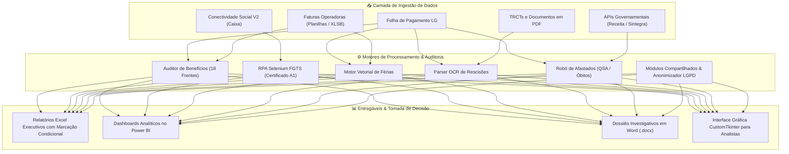

# 🏛️ Enterprise Payroll Audit & HR Data Engineering Suite
### Ecossistema Integrado de Engenharia de Dados, Auditoria Contínua & Automação de Recursos Humanos


---

## 📖 Visão Executiva

Este repositório consolida o **ecossistema corporativo completo de engenharia de dados, automações de processos (RPA), compliance trabalhista e auditoria contínua de folha de pagamento** desenvolvido para operar em escala corporativa (milhares de colaboradores, múltiplos CNPJs e unidades espalhadas em nível nacional).

O objetivo principal da suíte é **eliminar pagamentos indevidos, erradicar glosas contratuais de operadoras de benefícios, blindar passivos trabalhistas (CLT/eSocial/SST) e transformar processos manuais de Departamento Pessoal em pipelines analíticos de alta performance**.

---

## 🗺️ Mapa dos 13 Módulos Integrados

| # | Módulo | Foco de Negócio & Escopo | Status |
|:---:|:---|:---|:---:|
| **01** | [🍱 Benefícios Corporativos & VA/VT](modules/01_beneficios_va_vt/) | 18 conferências oficiais (VT 6%, Good Card, CVE, Cencopay, Refeitório) | `Concluído` |
| **02** | [🛡️ Auditoria de Seguro de Vida](modules/02_seguro_de_vida/) | Conciliação de apólice básica e capitais ampliados (12x e 24x salariais) | `Concluído` |
| **03** | [💳 Extrato de Ticket Plus / Compras](modules/03_extrato_ticket_plus/) | Robô de extração e consolidação analítica de extratos de convênio | `Concluído` |
| **04** | [🌐 Automação do Conectividade Social](modules/04_conectividade_social/) | RPA Selenium + Certificado Digital A1 no Windows para saldo FGTS | `Concluído` |
| **05** | [⏱️ Auditoria de Ponto e Frequência](modules/05_ponto_e_frequencia/) | Jornadas críticas (Art. 59 CLT), sobreaviso, atestados e controle de DSR | `Concluído` |
| **06** | [🤝 Relações Sindicais & CCTs](modules/06_relacoes_sindicais/) | Enquadramento por unidade, adicional por feriados e regras sindicais | `Concluído` |
| **07** | [💰 Folha de Pagamento & Encargos](modules/07_folha_e_encargos/) | Malha fina de eventos, gratificações manuais atípicas e SLAs do CSC | `Concluído` |
| **08** | [🏖️ Auditoria Integral de Férias](modules/08_auditoria_ferias/) | Confronto vetorial duplo (recibo de férias vs folha mensal oficial v008) | `Concluído` |
| **09** | [📄 Conciliação de Rescisões](modules/09_conciliacao_rescisao/) | Pipeline OCR/Parser de TRCTs em PDF e batimento financeiro de verbas | `Homologação` |
| **10** | [🤖 Compliance Cadastral & Afastados](modules/10_compliance_afastados/) | Robô SintegraWS para detecção de fraudes, sócios em QSA, INSS e óbitos | `Concluído` |
| **11** | [📊 BI de Pré-Admissão & Admissão](modules/11_bi_pre_admissao/) | Dashboard executivo Power BI (.pbix) e scripts de esteira de candidatos | `Concluído` |
| **12** | [🖥️ App Desktop de Benefícios](modules/12_app_desktop_beneficios/) | Interface gráfica CustomTkinter para auditoria de saúde e odontologia | `Concluído` |
| **--** | [🛠️ Utilitários & Governança LGPD](utils/) | Anonimizador de dados, Salário Família e normalização de cargos | `Concluído` |

---

## 🏗️ Arquitetura da Solução



---

## 🛡️ Governança, Segurança e Conformidade com a LGPD

O repositório foi construído seguindo princípios rigorosos de **Security by Design** e **Privacidade de Dados (LGPD)**:
1. **Nenhum Dado Sensível no Versionamento:** Nenhuma planilha real (`.xlsx`, `.csv`, `.xlsb`), contracheque ou TRCT com dados de colaboradores (CPFs, nomes, salários, benefícios) é versionada no Git.
2. **Gestão de Segredos via `.env`:** Tokens de APIs (SintegraWS, InfoSimples) e credenciais de banco de dados são lidos exclusivamente a partir de variáveis de ambiente gerenciadas via `python-dotenv`.
3. **Anonimização Ativa:** Scripts de mascaramento irreversível em `utils/anonimizar_planilhas.py` garantem a criação segura de bases simuladas (*mock data*) para homologação e demonstrações públicas.

---

## 💻 Tecnologias Empregadas

* **Linguagem Principal:** Python 3.10+
* **Engenharia e Processamento de Dados:** Pandas, NumPy, OpenPyXL, PyXLSB, XLRD, XlsxWriter
* **Visão Computacional e Parsing Documental:** PDFPlumber, PyPDF, Python-Docx
* **RPA e Automação Web:** Selenium WebDriver, Windows CryptoAPI
* **Business Intelligence & Storytelling:** Microsoft Power BI, DAX, PowerPoint
* **Desenvolvimento de Interfaces Desktop:** CustomTkinter, Tkinter, Pillow
* **Integrações RESTful:** Requests, JSON Cache Engine, APIs SintegraWS e InfoSimples

---

## 🚀 Como Executar o Projeto Localmente

### 1. Clonar o Repositório
```bash
git clone https://github.com/xeuhT/meus-projetos.git
cd meus-projetos
```

### 2. Criar e Ativar o Ambiente Virtual
```bash
python -m venv .venv

# No Windows:
.venv\Scripts\activate

# No Linux / macOS:
source .venv/bin/activate
```

### 3. Instalar as Dependências
```bash
pip install -r requirements.txt
```

### 4. Configurar as Variáveis de Ambiente
Copie o template de variáveis e informe seus tokens locais:
```bash
cp .env.example .env
```

---

## 👨‍💻 Autor & Engenharia
Projeto concebido e desenvolvido por **Matheus Cavalcanti** — Especialista em Automação, Engenharia de Dados e Compliance em RH/DP.
