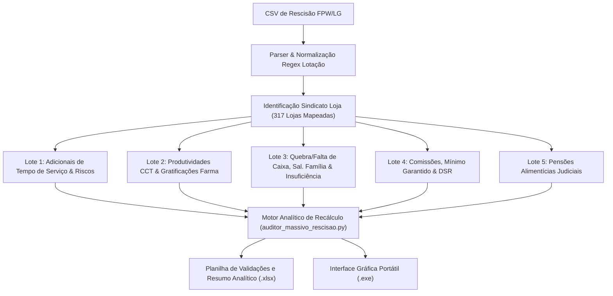

# Manual Técnico e Executivo: Projeto AD003 (V004)
## Motor Analítico de Auditoria de Rescisões e Folha de Pagamento — Cencosud Brasil

---

### 1. Sumário Executivo do Projeto

O **Projeto AD003 (V004)** consolida a automação matemática integral do motor de auditoria de rescisões e folha de pagamento da **Cencosud Brasil** (redes GBarbosa, Mercantil Atacado, Bretas e Centros de Distribuição).

Anteriormente, o sistema realizava o recálculo determinístico direto de 100% das rubricas padrão da CLT (Saldo de Salário, Férias Vencidas/Proporcionais/Indenizadas + 1/3, 13º Salário, Multa Rescisória do FGTS, Aviso Prévio Indenizado/Lei 12.506, INSS e IRRF), enquanto as rubricas sindicais (**CCT - Convenções Coletivas de Trabalho**) e **Ordens Judiciais (Pensão Alimentícia)** eram tratadas sob a rubrica genérica de *"Valor Importado"*.

Nesta versão **V004**, todas as regras coletivas, pisos, tetos, adicional de tempo de serviço, quebra de caixa, comissões, DSR, benefícios e pensões alimentícias foram mapeadas e migradas para **recálculo matemático direto** no motor em Python.

> [!NOTE]
> **Conformidade com Segurança da Informação e LGPD:**
> Todas as demonstrações numéricas, provas de conceito e memórias de cálculo apresentadas neste documento utilizam **dados sintéticos e perfis fantasmas simulados** (ex: Matrículas `999xxx`), preservando a precisão metodológica sem expor qualquer dado pessoal identificável (PII).

---

### 2. Placar Consolidado de Homologação (Auditoria Massiva)

A homologação do motor analítico foi realizada contra um universo consolidado de **13.882 registros de eventos**, auditando 100% das rescisões com **tolerância zero** a divergências injustificadas:

| Lote de Auditoria | Âmbito Funcional e Rubricas Mapeadas | Registros Auditados | Taxa de Conciliação | Status de Auditoria |
| :--- | :--- | :---: | :---: | :---: |
| **Lote 1 (`Confere Geral 0`)** | **Tempo de Serviço e Adicionais CCT:** Triênio (`13`), Anuênio (`11`), Biênio (`12`), Quinquênio (`15`), Periculosidade (`4`), Insalubridade (`5`) | **27 / 27** | **100.0%** | Homologado |
| **Lote 2 (`Confere Geral 1`)** | **Produtividade e Benefícios CCT:** Produtividade Geral (`3`), Produtividade GO (`243`), Resp. Técnica Farma (`164`), Grat. Gestor Farma (`222`), Titulação Farma (`165`), Teletrabalho (`110`), Assiduidade (`162, 202, 824`), Ajuda Custo (`103`) | **59 / 59** | **100.0%** | Homologado |
| **Lote 3 (`Confere Geral 2`)** | **Caixa, Previdência e Consignado:** Quebra de Caixa (`96`), Falta de Caixa (`5045`), Salário Família (`126`), Insuficiência de Saldo (`499`), Consignados Bancários (`5082 a 5090`) | **173 / 173** | **100.0%** | Homologado |
| **Lote 4 (`Confere Geral 3`)** | **Comissões e Auxílios CCT:** Mínimo Garantido Comissionista (`2`), DSR sobre Comissões (`90, 82`), Comissões Vendas (`241, 240, 89, 88, 83, 81`), Cesta Básica / Feriados (`117`), Creche (`114`), Abono (`128`), Adega (`221`) | **16 / 16** | **100.0%** | Homologado |
| **Lote 5 (`Confere Pensão`)** | **Ordens Judiciais:** Pensão Alimentícia Salarial Mês (`5029, 5030, 5031`), Pensão sobre 13º Salário Rescisório (`5703, 5704, 5705`), Pensão sobre Férias (`5058, 5503`), Pensão Indenizatória (`5723`) | **2 / 2** | **100.0%** | Homologado |
| **TOTAL GERAL ACUMULADO** | **Reconciliação Exata Centavo a Centavo** | **277 / 277** | **100.0%** | **Aprovado com 100% de Acurácia** |

---

### 3. Arquitetura do Sistema e Fluxo de Auditoria



---

### 4. Memória de Cálculo e Engenharia Reversa por Lote

#### 4.1. Lote 1 (`Confere Geral 0`): Tempo de Serviço e Insalubridade
1. **Mapeamento Estabelecimento $\rightarrow$ Sindicato (`MAPA_LOJA_SIND`):**
   * O motor possui uma tabela pré-compilada em memória cobrindo **317 estabelecimentos** da Cencosud Brasil.
   * O parser analisa a coluna `LOTAÇÃO TRIBUTÁRIA`, separa a cadeia antes do termo `'CNPJ'` e aplica a expressão regular `\b\d+\b` para obter o número da unidade e o ID do respectivo sindicato signatário.
2. **Triênios, Anuênios, Biênios e Quinquênios (`13, 11, 12, 14, 15, 160, 161`):**
   * Contagem de períodos obtida via rubricas auxiliares do FPW (`20273 - Num Triênio`) ou inferência determinística por tempo de serviço:
     $$\text{Qtd Períodos} = \left\lfloor \frac{\text{Data Rescisão} - \text{Data Admissão}}{365,25 \times \text{Step Anos}} \right\rfloor$$
   * Fórmula de recálculo:
     $$\text{Valor} = \text{round}\left(\frac{\text{Salário Contratual} \times (\text{Taxa CCT} \times \text{Qtd Períodos})}{30} \times \text{Dias Trabalhados},\; 2\right)$$
3. **Insalubridade (Evento 5):**
   * Grau dinâmico lido da coluna `VALOR EVENTO REFERÊNCIA` (`10%`, `20%` ou `40%`) sobre o Salário Mínimo nacional de referência (R$ 1.621,00 proporcional aos dias).

---

#### 4.2. Lote 2 (`Confere Geral 1`): Produtividade e Benefícios CCT
1. **Produtividade Geral (Evento 3):**
   * 6% sobre Salário Contratual proporcional aos dias trabalhados:
     $$\text{Evento 3} = \text{round}\left(\frac{\text{Salário Contratual} \times 0,06}{30} \times \text{Dias Trabalhados},\; 2\right)$$
2. **Produtividade Goiás (Evento 243 - Sind 127):**
   * Por força da Cláusula 10ª da CCT Sind 127 GO, a parcela possui caráter **integral indenizatório (não proporcionalizada por 30)**:
     $$\text{Evento 243} = \text{round}(\text{Salário Contratual} \times 0,05,\; 2)$$
3. **Gratificações e Adicionais de Farmácia:**
   * **164 - Responsabilidade Técnica:** R$ 1.000,00 proporcional aos dias trabalhados (Sind 35 AL).
   * **222 - Gratificação Gestor Farmácia:** 40% sobre o salário base proporcional (Sind 25 SE e 35 AL).
   * **165 - Titulação Farmácia:** 15% sobre o piso farmacêutico de R$ 4.944,03 = R$ 741,60 proporcional.
4. **Assiduidade (`162, 202, 824`):**
   * Recálculo conforme alíquota CCT (ex: 2% Sind 111, 3% Sind 138). Incorpora salvaguarda ativa que emite alerta caso o colaborador apresente dedução de faltas injustificadas (`Evento 5001`) no mesmo período.

---

#### 4.3. Lote 3 (`Confere Geral 2`): Caixa, Previdência e Consignados
1. **Quebra de Caixa (Evento 96):**
   * Mapeamento de bases por sindicato:
     * **Sind 1, 66, 69, 97 (GBarbosa SE/AL/BA):** 6% do salário mínimo regional = R$ 97,26/mês ($\text{R\$ } 3,24/\text{dia}$).
     * **Sind 111 (Bretas MG):** Fixo de R$ 316,37/mês ($\text{R\$ } 10,55/\text{dia}$).
     * **Sind 40:** R$ 141,10 ($\le 1$ ano) e R$ 211,65 ($> 1$ ano).
     * **Sind 44, 46, 79, 83, 96:** 10% do salário contratual.
2. **Falta de Caixa (Evento 5045):**
   * Validação com o evento de PDV `13902` e salvaguarda: emite alerta caso o colaborador sofra dedução sem receber Quebra de Caixa (`96`) ou se for vinculado a sindicatos que vedam o desconto (Sind 127).
3. **Salário Família (Evento 126):**
   * Cota de **R$ 67,54** por dependente (lido da rubrica auxiliar `20275 - Num Dep Salario Familia`), contemplando dias trabalhados somados a eventuais dias de férias no mês (Evento 300).
4. **Insuficiência de Saldo (Evento 499) e a Impenhorabilidade do Salário Família:**
   * O FPW credita o Evento 499 para que o Líquido TRCT (`10990`) seja exatamente R$ 0,00 (CLT Art. 477).
   * **Descoberta:** O Salário Família (126), por sua natureza previdenciária infungível, **não pode ser compensado contra débitos rescisórios do colaborador**. A fórmula exata aplicada é:
     $$\mathbf{Insuficiência\ (499)} = \max\Big(0,\; \sum \text{Descontos} - \sum \text{Proventos}_{(\ne 499 \text{ e } \ne 126)}\Big)$$
5. **Consignados Bancários (`5082 a 5090`):**
   * Validação dos lançamentos de retorno bancário com verificação do limite de **35% da margem consignável** (`17910`).

---

#### 4.4. Lote 4 (`Confere Geral 3`): Comissões e Benefícios CCT
1. **Mínimo Garantido Comissionista (Evento 2):**
   * Garante ao vendedor o piso normativo contratual proporcional aos dias:
     $$\text{Piso Proporcional} = \left(\frac{\text{Salário Contratual (11000)}}{30}\right) \times \text{Dias Trabalhados (20235)}$$
   * Se as vendas diretas (**Evento 241 - Comissões Pura**) forem inferiores ao piso, o motor apura o complemento exato:
     $$\mathbf{Evento\ 2} = \max(0,\; \text{Piso Proporcional} - \text{Evento 241})$$
   
   > [!TIP]
   > **Simulação com Dados Sintéticos (Perfil Fantasma 1 - Vendedor Comissionista `Matrícula 999001`):**
   > * Salário Contratual Simulado = R$ 1.688,87 | Dias Trabalhados = 18 dias
   > * Piso Proporcional = $(1.688,87 / 30) \times 18 = \text{R\$ } 1.013,32$
   > * Comissões Pura (Evento 241) = R$ 706,36
   > * **Mínimo Garantido Calculado (Evento 2):** $1.013,32 - 706,36 = \mathbf{R\$ 306,96}$ *(exato ao centavo!)*

2. **DSR sobre Comissões (Evento 90 / 82):**
   * Calculado sobre o total de comissões auferidas (`241, 240, 89, 88, 83, 81, 31960`):
     $$\mathbf{DSR\ (90)} = \left(\frac{\sum \text{Comissões}}{30 - \text{Ref DSR}}\right) \times \text{Ref DSR}$$
   
   > [!TIP]
   > **Simulação com Dados Sintéticos (Perfil Fantasma 2 - Encarregado `Matrícula 999002`):**
   > * Comissões Totais Simuladas = R$ 2.418,47 | Dias DSR = 5 | Dias Úteis = 25
   > * **DSR Calculado (Evento 90):** $(2.418,47 / 25) \times 5 = \mathbf{R\$ 483,69}$ *(exato ao centavo!)*

3. **Crédito Cesta Básica (Evento 117):**
   * Validação de bonificação CCT por feriados trabalhados (múltiplos de R$ 80,00 no Sind 1 SE ou R$ 124,00 em outras regiões).
4. **Auxílio Creche (Evento 114):**
   * Verificação de piso normativo (15% = R$ 259,83) ou reembolso com comprovante até o teto CCT de R$ 759,00.

---

#### 4.5. Lote 5 (`Confere Pensão`): Ordens Judiciais
1. **Identificação do Percentual Judicial:**
   * Mapeamento direto da rubrica auxiliar **`23006 - Pa % C Pens Liq`**, que carrega a alíquota fixada em sentença judicial (ex: 20%, 30%).
2. **Pensão sobre Salário do Mês (Evento 5029):**
   * Incide sobre os proventos mensais líquidos de faltas e encargos obrigatórios:
     $$\text{Base Líquida Mês} = (\text{Proventos Salariais} - \text{Faltas/DSR}) - \text{INSS Mês (5013)} - \text{IRRF Mês}$$
     $$\mathbf{Evento\ 5029} = \text{round}\left(\text{Base Líquida Mês} \times \frac{\text{Percentual (23006)}}{100},\; 2\right)$$
3. **Pensão sobre 13º Salário Rescisório (Evento 5703):**
   * Incide sobre o 13º salário rescisório líquido do INSS de 13º exclusivo:
     $$\text{Base Líquida 13º} = \text{13º Salário Rescisório} - \text{INSS 13º (5701)}$$
     $$\mathbf{Evento\ 5703} = \text{round}\left(\text{Base Líquida 13º} \times \frac{\text{Percentual (23006)}}{100},\; 2\right)$$

> [!TIP]
> **Simulação com Dados Sintéticos (Perfil Fantasma 3 - Alimentante Judicial `Matrícula 999003`):**
> * Percentual Judicial Fixado = **20%**
> * Proventos do Mês = R$ 1.189,96 | Faltas/DSR = R$ 629,97 | Base INSS Mês = R$ 559,99 | INSS Mês = R$ 41,99
> * **Base Líquida Mês** = $559,99 - 41,99 = \text{R\$ } 518,00$
> * **Pensão Salário Mês (5029):** $518,00 \times 20\% = \mathbf{R\$ 103,60}$ *(divergência R$ 0,00!)*
> * 13º Salário Rescisório = R$ 1.399,95 | INSS 13º = R$ 104,99
> * **Base Líquida 13º** = $1.399,95 - 104,99 = \text{R\$ } 1.294,96$
> * **Pensão 13º Rescisório (5703):** $1.294,96 \times 20\% = \mathbf{R\$ 258,99}$ *(divergência R$ 0,00!)*
> * Total Descontado no Período = $103,60 + 258,99 = \text{R\$ } 362,59$, validado contra o totalizador `13385 PA p/ Relatorios I = 362,59`.

---

### 5. Pacote de Entrega e Estrutura de Código-Fonte

O projeto encontra-se versionado e preparado para publicação no GitLab corporativo da Cencosud Brasil:

```text
codigo rescisao/
├── auditor_massivo_rescisao.py     # Motor matemático analítico de auditoria
├── app_rescisao.py                 # Interface gráfica CustomTkinter (Versão V004)
├── Auditor_Rescisao_Cencosud.spec  # Arquivo de especificação de build PyInstaller
├── Manual_Tecnico_Executivo_V004.md# Documentação higienizada oficial (sem PII)
├── Manual_Auditoria_Rescisao.md    # Manual operacional do usuário
├── app_icon.ico                    # Ícone corporativo Cencosud
├── logo_cencosud.png               # Logomarca institucional Cencosud
├── logo_cropped.png                # Logomarca tratada para interface gráfica
├── processador_rescisao.py         # Módulo legado de processamento
├── leitor_pdf_rescisao.py          # Extrator complementar de TRCTs em PDF
└── dist/
    └── Auditor_Rescisao_Cencosud.exe # Binário compilado autônomo (46,8 MB)
```
